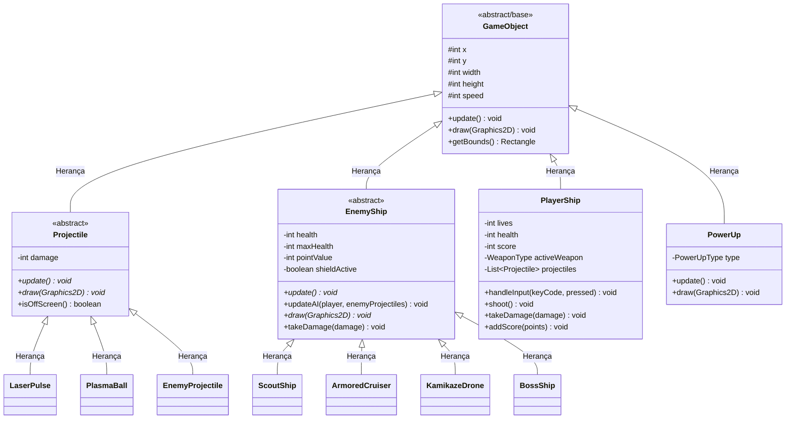

# 🚀 Space Defender: Galaxy Core
## 📚 Guia Definitivo dos 4 Pilares da POO (Formato Obsidian)

> [!abstract] Contexto Acadêmico
> Este documento foi estruturado especificamente para o estudo e apresentação da avaliação do **Jogo 2D Java em Dupla**, correspondente a **55% da nota docente**, cobrindo com rigor conceitual e evidências práticas de código os **4 Pilares da Orientação a Objetos**:
> 1. **[[#1. Abstração (Abstraction)|Abstração]]**
> 2. **[[#2. Encapsulamento (Encapsulation)|Encapsulamento]]**
> 3. **[[#3. Herança (Inheritance)|Herança]]**
> 4. **[[#4. Polimorfismo (Polymorphism)|Polimorfismo]]**

---



---

## 1. Abstração (Abstraction)

> [!quote] Definição Teórica para o Professor
> *"A Abstração consiste em isolar as características essenciais de um objeto ou subsistema do domínio, omitindo detalhes acidentais de implementação. Na POO, expressamos abstração por meio de classes abstratas e interfaces que definem contratos operacionais (`update`, `draw`), permitindo que o restante do sistema interaja com conceitos de alto nível sem se preocupar com suas particularidades internas."*

### 📌 Evidência 1.1: Superclasse Abstrata de Entidades
- **Arquivo:** `src/br/com/spacedefender/GameObject.java`
- **Linhas:** 10 - 35
```java
public class GameObject {
    protected int x;
    protected int y;
    protected int width;
    protected int height;
    protected int speed;

    public GameObject(int x, int y, int width, int height, int speed) {
        this.x = x;
        this.y = y;
        this.width = width;
        this.height = height;
        this.speed = speed;
    }

    /**
     * Atualização de lógica, física e coordenadas do objeto a cada ciclo do Game Loop.
     */
    public void update() {}

    /**
     * Renderização visual do objeto através do Graphics2D.
     */
    public void draw(Graphics2D g2d) {}

    /**
     * Retorna o retângulo de colisão da entidade (AABB).
     */
    public Rectangle getBounds() {
        return new Rectangle(x, y, width, height);
    }
```
> [!tip] O que falar na apresentação
> "A classe `GameObject` abstrai o que significa ser uma entidade física no espaço bidimensional do jogo: qualquer objeto no cosmos precisa de coordenadas `(x, y)`, dimensões `(width, height)`, velocidade e um ciclo de vida composto por atualizar sua física (`update()`) e ser desenhado na tela (`draw()`). Ela esconde a complexidade de delimitação geométrica provendo o método `getBounds()` para colisão AABB."

---

### 📌 Evidência 1.2: Contrato Abstrato de Projéteis
- **Arquivo:** `src/br/com/spacedefender/projectiles/Projectile.java`
- **Linhas:** 10 - 29
```java
public abstract class Projectile extends GameObject {
    private int damage;

    public Projectile(int x, int y, int width, int height, int speed, int damage) {
        super(x, y, width, height, speed);
        this.damage = damage;
    }

    /**
     * Atualização da física do projétil a cada ciclo de clock do Game Loop.
     */
    @Override
    public abstract void update();

    /**
     * Renderização visual polimórfica específica de cada projétil.
     */
    @Override
    public abstract void draw(Graphics2D g2d);
```
> [!tip] O que falar na apresentação
> "A classe `Projectile` é declarada como `abstract` porque não existe um 'tiro genérico' concreto trafegando na tela: todo tiro precisa ser ou um pulso laser rápido ou uma esfera de plasma massiva. Os métodos `update()` e `draw()` abstratos forçam todas as classes filhas a implementarem sua própria física e seu próprio desenho gráfico."

---

### 📌 Evidência 1.3: Contrato Abstrato de Inimigos e Ciclo de IA
- **Arquivo:** `src/br/com/spacedefender/enemies/EnemyShip.java`
- **Linhas:** 10 - 45
```java
public abstract class EnemyShip extends GameObject {
    private int health;
    private int maxHealth;
    private int pointValue;
    private double speedY;
    private boolean shieldActive = false;
    private long shieldEndTime = 0;

    public EnemyShip(int x, int y, int width, int height, int speed, int health, int pointValue) {
        super(x, y, width, height, speed);
        this.health = health;
        this.maxHealth = health;
        this.pointValue = pointValue;
        this.speedY = speed;
    }

    @Override
    public abstract void update();

    public void updateAI(br.com.spacedefender.entities.PlayerShip player, java.util.List<br.com.spacedefender.projectiles.EnemyProjectile> enemyProjectiles) {
        update();
    }

    @Override
    public abstract void draw(Graphics2D g2d);
```
> [!tip] O que falar na apresentação
> "`EnemyShip` encapsula a abstração completa de uma nave invasora: ela tem blindagem, pontuação concedida ao jogador e o contrato de IA (`updateAI`), abstraindo se a nave é um drone kamikaze veloz ou um cruzador couraçado com escudos de energia."

---

### 📌 Evidência 1.4: Abstração de Alto Nível de Áudio e DSP
- **Arquivo:** `src/br/com/spacedefender/audio/SoundManager.java`
- **Linhas:** 75 - 100
```java
    /**
     * Toca o efeito sonoro especificado de forma assíncrona.
     */
    public void play(SoundType type) {
        if (!audioAvailable || muted || volume <= 0.01f || type == null) {
            return;
        }

        Clip[] pool = soundPools.get(type);
        if (pool == null || pool.length == 0) {
            return;
        }

        int index = poolIndices.getOrDefault(type, 0);
        Clip clip = pool[index];
        poolIndices.put(type, (index + 1) % pool.length);

        if (clip != null) {
            try {
                if (clip.isRunning()) {
                    clip.stop();
                }
                clip.setFramePosition(0);
                clip.start();
            } catch (Throwable ignored) {
            }
        }
    }
```
> [!tip] O que falar na apresentação
> "Aqui aplicamos Abstração para isolar uma das APIs mais complexas do Java (`javax.sound.sampled`). O resto do jogo não precisa entender sobre síntese senoidal, frequências em Hertz, buffers PCM de 16-bit ou decibéis logarítmicos. O desenvolvedor apenas chama `SoundManager.getInstance().play(SoundType.EXPLOSION)`."

---

## 2. Encapsulamento (Encapsulation)

> [!quote] Definição Teórica para o Professor
> *"O Encapsulamento é o mecanismo que oculta os dados internos de um objeto (`information hiding`), expondo apenas interfaces públicas seguras (`getters`, `setters` e métodos de negócio). Ele garante a integridade dos dados, impedindo estados inválidos (ex: vida negativa, pontuação corrompida) e assegura que efeitos colaterais obedeçam estritamente às regras de negócio do jogo."*

### 📌 Evidência 2.1: Atributos Privados e Validação de Dano com Escudo
- **Arquivo:** `src/br/com/spacedefender/entities/PlayerShip.java`
- **Linhas:** 20 - 35 e 268 - 281
```java
    // Atributos protegidos por modificador privado
    private int lives = 3;
    private int maxHealth = 100;
    private int health = 100;
    private int score = 0;
    private long lastShotTime = 0;
    private WeaponType activeWeapon = WeaponType.LASER;
    private List<Projectile> projectiles = new ArrayList<>();

    // Estados e Temporizadores de Power-Ups encapsulados
    private boolean doubleScoreActive = false;
    private long doubleScoreEndTime = 0;
    private boolean tripleShotActive = false;
    private long tripleShotEndTime = 0;
    private boolean shieldActive = false;
    private long shieldEndTime = 0;
```
```java
    public void takeDamage(int damage) {
        // Se o escudo de força estiver ativo, o dano é 100% absorvido!
        if (shieldActive) {
            return;
        }

        if (damage > 0) {
            SoundManager.getInstance().play(SoundType.PLAYER_HIT);
            this.health -= damage;
            if (this.health <= 0) {
                this.health = 0; // Impede que a vida fique negativa
            }
        }
    }
```
> [!tip] O que falar na apresentação
> "Nenhum código externo consegue fazer `player.health = -50`. A alteração do estado ocorre via `takeDamage()`, que aplica regras de negócio: se o Power-Up de escudo (`shieldActive`) estiver ligado, o dano é bloqueado; caso contrário, toca o som de alerta, reduz a vida e garante que ela nunca fique abaixo de 0."

---

### 📌 Evidência 2.2: Regra de Negócio de Pontuação com Buff Ativo
- **Arquivo:** `src/br/com/spacedefender/entities/PlayerShip.java`
- **Linhas:** 320 - 330
```java
    public int getScore() { return score; }

    public void addScore(int points) {
        if (points > 0) {
            if (doubleScoreActive) {
                score += (points * 2);
            } else {
                score += points;
            }
        }
    }
```
> [!tip] O que falar na apresentação
> "O método `addScore()` encapsula a regra da pílula de pontuação dupla: a classe consumidora simplesmente envia os pontos normais da nave inimiga (ex: 100 pontos), e o próprio objeto `PlayerShip` decide se deve conceder 100 ou 200 pontos de acordo com seu estado interno protegido."

---

### 📌 Evidência 2.3: Imutabilidade e Proteção da Lista de High Scores
- **Arquivo:** `src/br/com/spacedefender/managers/HighScoreManager.java`
- **Linhas:** 40 - 43
```java
    public synchronized List<ScoreEntry> getScores() {
        return Collections.unmodifiableList(new ArrayList<>(scores));
    }
```
> [!tip] O que falar na apresentação
> "Para evitar que classes visuais alterem ou limpem a lista de recordes diretamente, o método `getScores()` retorna uma visão imutável via `Collections.unmodifiableList()`. Qualquer tentativa externa de chamar `.clear()` ou `.add()` disparará uma `UnsupportedOperationException`, blindando os dados."

---

### 📌 Evidência 2.4: Encapsulamento de Propriedades no Enum de Armas
- **Arquivo:** `src/br/com/spacedefender/projectiles/WeaponType.java`
- **Linhas:** 6 - 29
```java
public enum WeaponType {
    LASER("Laser Pulse", 10, 160),
    PLASMA("Plasma Ball", 25, 420);

    private final String displayName;
    private final int damage;
    private final long cooldownMs;

    WeaponType(String displayName, int damage, long cooldownMs) {
        this.displayName = displayName;
        this.damage = damage;
        this.cooldownMs = cooldownMs;
    }

    public String getDisplayName() { return displayName; }
    public int getDamage() { return damage; }
    public long getCooldownMs() { return cooldownMs; }
}
```
> [!tip] O que falar na apresentação
> "Os valores de dano e cadência de tiro (cooldown) são encapsulados e imutáveis (`final`) dentro do Enum `WeaponType`, impedindo que uma arma altere seu comportamento sem autorização."

---

## 3. Herança (Inheritance)

> [!quote] Definição Teórica para o Professor
> *"A Herança expressa a relação semântica de 'é-um' (`is-a`), permitindo que subclasses herdem campos e comportamentos de uma superclasse comum, promovendo o reuso estrito de código e eliminando duplicações (princípio DRY - Don't Repeat Yourself)."*

### 📌 Evidência 3.1: Hierarquia de Projéteis do Jogador
- **Superclasse:** `src/br/com/spacedefender/projectiles/Projectile.java` (Linha 10)
  ```java
  public abstract class Projectile extends GameObject
  ```
- **Subclasse Concreta:** `src/br/com/spacedefender/projectiles/LaserPulse.java`
- **Linhas:** 10 - 19
```java
public class LaserPulse extends Projectile {
    private static final int DEFAULT_WIDTH = 4;
    private static final int DEFAULT_HEIGHT = 16;
    private static final int DEFAULT_SPEED = 12;
    private static final int DEFAULT_DAMAGE = 10;

    public LaserPulse(int x, int y) {
        super(x, y, DEFAULT_WIDTH, DEFAULT_HEIGHT, DEFAULT_SPEED, DEFAULT_DAMAGE);
    }
```
- **Subclasse Concreta:** `src/br/com/spacedefender/projectiles/PlasmaBall.java`
- **Linhas:** 10 - 19
```java
public class PlasmaBall extends Projectile {
    private static final int DEFAULT_SIZE = 14;
    private static final int DEFAULT_SPEED = 7;
    private static final int DEFAULT_DAMAGE = 25;

    public PlasmaBall(int x, int y) {
        super(x, y, DEFAULT_SIZE, DEFAULT_SIZE, DEFAULT_SPEED, DEFAULT_DAMAGE);
    }
```
> [!tip] O que falar na apresentação
> "`LaserPulse` e `PlasmaBall` *são* projéteis (`is-a Projectile`). Graças à herança, ambas reutilizam a detecção de saída da tela (`isOffScreen()`), o retângulo de colisão (`getBounds()`), as coordenadas e o dano, repassando suas configurações especializadas ao construtor da superclasse via `super(...)`."

---

### 📌 Evidência 3.2: Hierarquia das Naves Inimigas
- **Superclasse:** `src/br/com/spacedefender/enemies/EnemyShip.java` (Linha 10)
  ```java
  public abstract class EnemyShip extends GameObject
  ```
- **Subclasses Especializadas:**
  - `ScoutShip extends EnemyShip` (Nave batedora veloz e ágil)
  - `ArmoredCruiser extends EnemyShip` (Cruzador resistente com escudo e canhão)
  - `KamikazeDrone extends EnemyShip` (Drone suicida teleguiado)
  - `BossShip extends EnemyShip` (Chefe de fase com 2 fases e barra de vida massiva)

Trecho de `src/br/com/spacedefender/enemies/ArmoredCruiser.java` (Linhas 11 - 22):
```java
public class ArmoredCruiser extends EnemyShip {
    private static final int DEFAULT_WIDTH = 55;
    private static final int DEFAULT_HEIGHT = 45;
    private static final int DEFAULT_SPEED = 1;
    private static final int DEFAULT_HEALTH = 80;
    private static final int DEFAULT_POINTS = 250;

    public ArmoredCruiser(int x, int y) {
        super(x, y, DEFAULT_WIDTH, DEFAULT_HEIGHT, DEFAULT_SPEED, DEFAULT_HEALTH, DEFAULT_POINTS);
    }
```
> [!tip] O que falar na apresentação
> "Todas as naves invasoras herdam os atributos `health`, `maxHealth`, `pointValue` e os métodos `takeDamage()` e `isDestroyed()` de `EnemyShip`. O cruzador não precisa reescrever como calcula se está destruído ou como toma dano; ele apenas herda essa inteligência."

---

### 📌 Evidência 3.3: Hierarquia de Power-Ups e Projéteis Inimigos
- `PowerUp extends GameObject`: Reaproveita física, velocidade e posição cartesiana.
- `EnemyProjectile extends Projectile`: Reaproveita cálculo de AABB e dano balístico, invertendo o sentido de deslocamento para baixo.

---

## 4. Polimorfismo (Polymorphism)

> [!quote] Definição Teórica para o Professor
> *"O Polimorfismo ('muitas formas') é a capacidade de tratar objetos de classes distintas sob um mesmo tipo genérico de referência, invocando métodos cujos comportamentos específicos são decididos dinamicamente em tempo de execução (`Dynamic Dispatch` ou ligação tardia). Ele elimina comandos condicionais extensos (`if/switch`) e permite que o sistema seja facilmente extensível (Princípio Aberto/Fechado do SOLID)."*

### 📌 Evidência 4.1: O Grande Laço Polimórfico de Atualização e IA
- **Arquivo:** `src/br/com/spacedefender/core/GamePanel.java`
- **Linhas:** 263 - 274
```java
            // Atualização polimórfica e IA das naves inimigas
            for (EnemyShip enemy : enemies) {
                enemy.updateAI(player, enemyProjectiles);
            }

            // Atualização polimórfica dos projéteis disparados pelos inimigos
            for (EnemyProjectile ep : enemyProjectiles) {
                ep.update();
            }
            enemyProjectiles.removeIf(EnemyProjectile::isOffScreen);

            // Resolução polimórfica de colisões
            collisionManager.checkCollisions(player, enemies, enemyProjectiles);
```
> [!tip] O que falar na apresentação
> "Observem a coleção `List<EnemyShip> enemies`. No laço `for (EnemyShip enemy : enemies)`, o compilador não sabe se a nave é um `ScoutShip`, `ArmoredCruiser`, `KamikazeDrone` ou `BossShip`. Em tempo de execução, a JVM invoca a versão exata de `updateAI()` de cada classe:
> - O **Scout** faz zigue-zague e esquiva evasiva;
> - O **Cruiser** dispara tiros e ativa escudo de força;
> - O **Kamikaze** acelera em direção ao X do jogador;
> - O **Boss** aciona a Fase 2 de fúria quando chega a 50% de HP.
> Tudo isso acontece sem um único `if (enemy instanceof ...)`!"

---

### 📌 Evidência 4.2: Renderização Polimórfica com Graphics2D
- **Arquivo:** `src/br/com/spacedefender/core/GamePanel.java`
- **Linhas:** 354 - 364
```java
    private void drawGameplay(Graphics2D g2d) {
        for (EnemyShip enemy : enemies) {
            enemy.draw(g2d);
        }
        for (EnemyProjectile ep : enemyProjectiles) {
            ep.draw(g2d);
        }
        powerUpManager.draw(g2d);
        player.draw(g2d);
        drawHUD(g2d);
    }
```
> [!tip] O que falar na apresentação
> "O método `drawGameplay` itera pelas naves e projéteis chamando `enemy.draw(g2d)`. Cada subclasse implementou sua própria arte vetorial: o Scout desenha asas triangulares finas; o Cruiser desenha casco duplo com torre de canhão; o Boss desenha uma nave-mãe gigante com reatores e barra de vida vermelha no topo da tela."

---

### 📌 Evidência 4.3: Sobrescrita de Física entre Tiros (Player vs Inimigo)
- **Tiro do Jogador (Sobe):** `src/br/com/spacedefender/projectiles/LaserPulse.java` (Linhas 21 - 23)
```java
    @Override
    public void update() {
        setY(getY() - getSpeed()); // Desloca para cima em direção ao topo da tela (-Y)
    }
```
- **Tiro do Inimigo (Desce):** `src/br/com/spacedefender/projectiles/EnemyProjectile.java` (Linhas 20 - 23)
```java
    @Override
    public void update() {
        setY(getY() + getSpeed()); // Desloca para baixo em direção à base da tela (+Y)
    }
```
> [!tip] O que falar na apresentação
> "Tanto o laser do jogador quanto o tiro disparado pelos inimigos herdam de `Projectile`. No entanto, eles aplicam polimorfismo de sobrescrita (`@Override`) no método `update()`: o tiro do jogador subtrai Y (sobe), enquanto o tiro inimigo soma Y (desce em direção à nave do jogador)."

---

### 📌 Evidência 4.4: Polimorfismo de Interface no Ranking
- **Arquivo:** `src/br/com/spacedefender/scores/ScoreEntry.java`
- **Linhas:** 8 - 45
```java
public class ScoreEntry implements Serializable, Comparable<ScoreEntry> {
    private final String initials;
    private final int score;
    private final int wave;
    private final long timestamp;

    @Override
    public int compareTo(ScoreEntry other) {
        // Ordenação decrescente por pontuação
        if (this.score != other.score) {
            return Integer.compare(other.score, this.score);
        }
        return Long.compare(other.timestamp, this.timestamp);
    }
```
> [!tip] O que falar na apresentação
> "`ScoreEntry` implementa a interface padrão do Java `Comparable<ScoreEntry>`. Isso permite que o método utilitário `Collections.sort(scores)` ordene polimorficamente o ranking de pontuações do fliperama sem precisar conhecer a estrutura interna da classe."

---

## 📋 Quadro Comparativo Resumido para a Apresentação

| Pilar POO | Conceito Central | Onde está no Space Defender? | Classe de Exemplo |
| :--- | :--- | :--- | :--- |
| **Abstração** | Ocultar detalhes e definir contratos operacionais essenciais. | Classes abstratas de entidades e contrato de ciclo de vida. | `GameObject`, `Projectile`, `EnemyShip`, `SoundManager` |
| **Encapsulamento** | Proteger estado interno e validar mutações por métodos seguros. | Atributos privados, absorção de dano por escudo e pontuação dupla. | `PlayerShip`, `HighScoreManager`, `WeaponType` |
| **Herança** | Reuso estrito de código e relação 'é-um'. | Hierarquia em 3 níveis: Base -> Projétil/Inimigo -> Subclasses. | `LaserPulse`, `ScoutShip`, `BossShip`, `PowerUp` |
| **Polimorfismo** | Execução dinâmica especializada sem acoplamento nem `if/else`. | Laço de Game Loop (`updateAI`, `draw`), disparos mútuos e `Comparable`. | `GamePanel` (loop de inimigos), `EnemyProjectile`, `ScoreEntry` |

---

## 🎯 Roteiro Rápido de Fala (Pitch de 2 minutos da Dupla)

1. **Abertura (Felipe):**
   > *"Professor, nosso jogo é o **Space Defender: Galaxy Core**, desenvolvido em Java Swing a 60 FPS com arquitetura limpa e GitFlow. Cada aspecto da arquitetura foi desenhado para expressar os 4 Pilares da Orientação a Objetos de forma autêntica."*

2. **Abstração e Herança (Bianca):**
   > *"Criamos a superclasse `GameObject` e a especializamos nas classes abstratas `Projectile` e `EnemyShip`. A Abstração nos deu os contratos `update()` e `draw()`, e a Herança permitiu que naves como o `ScoutShip`, o `ArmoredCruiser` e o `BossShip` herdassem vida, colisão e limites de tela sem duplicar uma única linha de código."*

3. **Encapsulamento e Polimorfismo (Felipe):**
   > *"O Encapsulamento protege a saúde e o placar do jogador: ao tomar dano, o método `takeDamage()` checa se o escudo de força absorve o impacto; ao pontuar, `addScore()` dobra os pontos automaticamente se o buff de 2X estiver ativo. E o Polimorfismo brilha no Game Loop do `GamePanel`, onde iteramos sobre uma `List<EnemyShip>` executando a IA e a renderização gráfica única de cada modelo de nave em tempo de execução!"*
