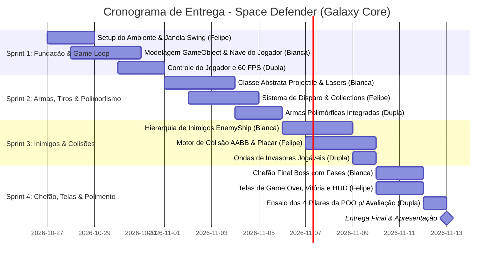

# 🚀 Cronograma de Desenvolvimento & Guia de Estudos NotebookLM
## Jogo 2D Java: *Space Defender: Galaxy Core*
- **Equipe:** [[Felipe Lopes]] & [[Bianca]]
- **Data Limite de Entrega:** 13 de Novembro de 2026
- **Professor Orientador:** Mestre em Back-End Java
- **Material Base:** [[Notion - Desenvolvimento Back-End JAVA (Prof. Cainã Antunes)]]

---

> [!QUOTE] Recado Acolhedor do Professor para Felipe e Bianca
> *"Felipe e Bianca, não se intimidem por não terem muita afinidade com a matéria neste momento! Todo grande desenvolvedor sênior um dia olhou para uma classe Java e se sentiu perdido. O segredo não é tentar aprender tudo de uma vez na véspera, mas sim **construir tijolo por tijolo**, entendendo o porquê de cada linha de código.
>
> Para que vocês nunca travem, estruturei este cronograma em **4 Sprints curtas**, dividindo com clareza as tarefas entre o Felipe e a Bianca. E o mais especial: cada tarefa possui um **Prompt cirúrgico pronto em bloco de código para vocês copiarem e colarem no Google NotebookLM** (que tem acesso às notas do Notion do prof. Cainã). O NotebookLM atuará como o tutor particular de vocês 24h por dia. Sigam este roteiro e o 10 na apresentação é garantido!"*

---

## 🗺️ Visão Geral das 4 Sprints (27/10 a 13/11)



---

## 🛠️ SPRINT 1: Fundação, Setup e a Nave do Jogador (27/10 a 31/10)

> [!TODO] Meta da Sprint 1
> Ter uma janela aberta rodando a 60 FPS estáveis onde a nave do jogador se move com as setas do teclado (ou WASD) sem sair dos limites da tela.

### 📌 Tarefa 1.1: Configuração do Projeto e Janela do Jogo (`JFrame` e `JPanel`)
- [ ] **Responsável:** Felipe
- **O que fazer na prática:**
  1. Criar um projeto Java limpo (usando VS Code, IntelliJ ou Eclipse) com o pacote `br.com.spacedefender`.
  2. Criar a classe `GameWindow` que estende `JFrame` e a classe `GamePanel` que estende `JPanel`.
  3. Definir o tamanho da janela (800x600 pixels), título *"Space Defender: Galaxy Core"*, `setDefaultCloseOperation(JFrame.EXIT_ON_CLOSE)` e `setResizable(false)`.
- **Conceito de Aula:** Estrutura de uma classe Java, métodos construtores, pacotes e herança básica com biblioteca gráfica (`javax.swing`).

> [!TIP] 🤖 Prompt para o Google NotebookLM (Copiar e Colar)
> ```text
> NotebookLM, baseado no Notion da disciplina 'Desenvolvimento Back-End - JAVA' (especialmente as Aulas 02 e 03 sobre estrutura de classes e o mini-projeto de telas/ScreenSaver): Eu e a Bianca estamos criando um jogo 2D simples em Java puro. Me explique de forma bem simples e didática o que é uma classe, para que serve o método construtor e como criar uma janela básica usando JFrame e JPanel no Java Swing para nosso jogo. Me dê um exemplo de código comentado passo a passo para um iniciante.
> ```

> [!WARNING] ⚠️ Dica do Mestre (Armadilha Comum)
> No Swing, use sempre `panel.setPreferredSize(new Dimension(800, 600))` e chame `frame.pack()` em vez de setar o tamanho fixo no frame, para que a barra de título do Windows não "roube" pixels da área jogável.

---

### 📌 Tarefa 1.2: A Abstração Central (`GameObject`) e Encapsulamento da Nave
- [ ] **Responsável:** Bianca
- **O que fazer na prática:**
  1. Criar a classe abstrata `GameObject` com os atributos privados: `double x`, `double y`, `int width`, `int height`, `double speed`.
  2. Implementar getters e setters com validação (encapsulamento).
  3. Criar os métodos abstratos: `public abstract void update();` e `public abstract void render(Graphics2D g);`.
  4. Criar a classe `PlayerShip extends GameObject` que herda de `GameObject` e adiciona atributos próprios como `int maxHealth`, `int currentHealth` e `int score`.
- **Conceito de Aula:** Aula 01 (Paradigma POO), Aula 02 (Encapsulamento com `private`, getters/setters) e Aula 05 (Abstração com classes e métodos `abstract`).

> [!TIP] 🤖 Prompt para o Google NotebookLM (Copiar e Colar)
> ```text
> NotebookLM, com base na Aula 01, 02 e 05 do Notion do prof. Cainã: O que significa 'Abstração' e 'Encapsulamento' na prática? Por que eu devo criar uma classe abstrata chamada 'GameObject' com atributos private e métodos abstract para meu jogo 2D, em vez de criar direto a nave do jogador? Me dê uma analogia simples e um exemplo de código mostrando a classe abstrata GameObject e a classe PlayerShip herdando dela.
> ```

> [!WARNING] ⚠️ Dica do Mestre (Armadilha Comum)
> Nunca deixe os atributos `x` e `y` como `public`. O professor vai verificar se os atributos estão `private` ou `protected` com getters/setters protegendo as regras de negócio!

---

### 📌 Tarefa 1.3: Game Loop a 60 FPS e Movimentação com Teclado
- [ ] **Responsável:** Felipe & Bianca (Pair Programming)
- **O que fazer na prática:**
  1. No `GamePanel`, implementar um loop de jogo usando `javax.swing.Timer` (disparando a cada 16ms, gerando 60 FPS) ou uma `Thread` com `Runnable`.
  2. Implementar `KeyListener` para capturar as teclas (Setas ou W, A, S, D).
  3. No método `update()` da `PlayerShip`, atualizar as coordenadas `x` e `y` conforme as teclas pressionadas e impedir que a nave saia da tela:
     `if (x < 0) x = 0; if (x > 800 - width) x = 800 - width;`
  4. No método `paintComponent(Graphics g)`, desenhar a nave usando `Graphics2D` ou um sprite PNG.
- **Conceito de Aula:** Tratamento de eventos (`EventListener`), loop de execução e sobreescrita de métodos (`@Override`).

> [!TIP] 🤖 Prompt para o Google NotebookLM (Copiar e Colar)
> ```text
> NotebookLM, consultando o material do Notion (Mini Projeto ScreenSaver e Aulas de Classes): O que é um 'Game Loop' em jogos 2D em Java e por que precisamos dele para atualizar a tela? Como posso usar um javax.swing.Timer e um KeyListener para fazer a minha nave se movimentar suavemente na tela a 60 quadros por segundo? Mostre um exemplo simples sem usar frameworks complexos.
> ```

> [!WARNING] ⚠️ Dica do Mestre (Armadilha Comum)
> Para a movimentação ficar fluida e sem engasgos, use variáveis booleanas (`upPressed`, `downPressed`, `leftPressed`, `rightPressed`). Ative-as no `keyPressed` e desative-as no `keyReleased`.

---

## 🔫 SPRINT 2: Armas, Tiros e o Pilar do Polimorfismo (01/11 a 05/11)

> [!TODO] Meta da Sprint 2
> A nave do jogador dispara projéteis ao apertar a barra de espaço. O código deve ter uma lista de projéteis e usar **Polimorfismo** com pelo menos dois tipos de tiros diferentes.

### 📌 Tarefa 2.1: A Hierarquia Polimórfica de Projéteis (`Projectile`)
- [ ] **Responsável:** Bianca
- **O que fazer na prática:**
  1. Criar a classe abstrata `Projectile extends GameObject`.
  2. Adicionar atributos encapsulados: `int damage`, `double speedY`.
  3. Criar duas classes filhas que herdam de `Projectile`:
     - `LaserPulse`: Tiro comum, rápido, causa 10 de dano, desenhado como um traço fino azul/ciano.
     - `PlasmaBall`: Tiro pesado, mais lento, causa 25 de dano, desenhado como um círculo maior de cor verde ou amarela.
  4. Sobrescrever o método `render(Graphics2D g)` e `update()` em cada uma delas de forma personalizada.
- **Conceito de Aula:** Aula 05 (Herança, Abstração e Polimorfismo). Este é o coração do que o professor pediu no quadro!

> [!TIP] 🤖 Prompt para o Google NotebookLM (Copiar e Colar)
> ```text
> NotebookLM, com base na Aula 05 do Notion ('Herança, Abstração e Polimorfismo'): Nós estamos criando o sistema de tiros do nosso jogo 2D. Explique o que é Polimorfismo de forma que uma pessoa sem muita experiência em programação entenda. Como eu crio uma classe abstrata Projectile e duas filhas (LaserPulse e PlasmaBall) para que cada uma se desenhe e cause dano diferente usando polimorfismo? Mostre o código Java comentado.
> ```

> [!WARNING] ⚠️ Dica do Mestre (Armadilha Comum)
> Repare que na chamada de desenho ou de movimento, você nunca vai perguntar `if (tiro instanceof LaserPulse)`. Você simplesmente chamará `tiro.render(g)` e o Java saberá sozinho qual método executar. É isso que o professor vai cobrar!

---

### 📌 Tarefa 2.2: O Gerenciador de Tiros com `Collections` (`ArrayList`)
- [ ] **Responsável:** Felipe
- **O que fazer na prática:**
  1. No `GamePanel`, criar uma lista genérica: `List<Projectile> projectiles = new ArrayList<>();`.
  2. Ao pressionar a barra de espaço, instanciar um novo tiro na posição atual da nave do jogador:
     `projectiles.add(new LaserPulse(player.getX() + 20, player.getY()));`.
  3. Criar um controle de cadência (*cooldown*) para que o jogador não dispare 60 tiros por segundo (ex: permitir um tiro a cada 200ms).
  4. Percorrer a lista no Game Loop para atualizar a posição de cada tiro e remover tiros que saíram do topo da tela (`y < -50`).
- **Conceito de Aula:** Aula 06 (Collections - `List` e `ArrayList`) e controle de concorrência/remoção.

> [!TIP] 🤖 Prompt para o Google NotebookLM (Copiar e Colar)
> ```text
> NotebookLM, de acordo com a Aula 06 do Notion ('Collections'): O que é a interface List e a classe ArrayList em Java? Como posso guardar e percorrer uma lista de objetos 'Projectile' no loop do jogo? Como remover com segurança da lista os tiros que saíram da tela sem causar o erro clássico 'ConcurrentModificationException'?
> ```

> [!WARNING] ⚠️ Dica do Mestre (Armadilha Comum)
> **Cuidado com a armadilha do `for-each`!** Se você fizer `for (Projectile p : projectiles) { if (saiuDaTela) projectiles.remove(p); }`, o Java vai lançar `ConcurrentModificationException` e travar seu jogo! Use `projectiles.removeIf(p -> p.getY() < 0);` ou percorra o loop de trás para frente (`for (int i = projectiles.size() - 1; i >= 0; i--)`).

---

### 📌 Tarefa 2.3: Alternância de Armas (Demonstração Prática de Polimorfismo)
- [ ] **Responsável:** Felipe & Bianca
- **O que fazer na prática:**
  1. Permitir que o jogador aperte a tecla `1` ou `2` (ou a tecla `Q`) para alternar a arma ativa da nave.
  2. Testar na tela: ao disparar no modo 1, saem lasers rápidos; ao disparar no modo 2, saem esferas de plasma.
  3. Garantir que o Game Loop trate ambos apenas como `Projectile` genérico.
- **Conceito de Aula:** Polimorfismo dinâmico em tempo de execução e encapsulamento de estado da arma.

> [!TIP] 🤖 Prompt para o Google NotebookLM (Copiar e Colar)
> ```text
> NotebookLM, revisando a Aula 05 e 07 do Notion: No nosso jogo espacial, queremos que o jogador aperte uma tecla e troque o tipo de tiro. Como usamos os princípios de Orientação a Objetos para alternar entre LaserPulse e PlasmaBall guardando apenas uma referência polimórfica para o tipo de arma ativa na classe PlayerShip?
> ```

---

## 👾 SPRINT 3: Invasores Espaciais e Matriz de Colisão (06/11 a 09/11)

> [!TODO] Meta da Sprint 3
> Naves inimigas surgem no topo da tela em ondas e descem em direção ao jogador. Tiros colidem com inimigos e os destroem. O jogador perde vida ao bater ou ser atingido.

### 📌 Tarefa 3.1: Hierarquia de Naves Inimigas (`EnemyShip`)
- [ ] **Responsável:** Bianca
- **O que fazer na prática:**
  1. Criar a classe abstrata `EnemyShip extends GameObject`.
  2. Adicionar atributos encapsulados: `int health`, `int pointValue`, `double speedY`.
  3. Criar duas subclasses de inimigos com comportamentos polimórficos:
     - `ScoutShip`: Inimigo leve e veloz, vida baixa (1 tiro destrói), desce em zigue-zague senoidal (`x += Math.sin(y * 0.05) * 3`).
     - `ArmoredCruiser`: Inimigo pesado e lento, vida alta (precisa de vários tiros), desce em linha reta e vale mais pontos.
  4. Sobrescrever o método `update()` e `render(Graphics2D g)` para cada um.
- **Conceito de Aula:** Aula 05 (Herança e Polimorfismo) e Aula 07 (Relacionamento entre Classes).

> [!TIP] 🤖 Prompt para o Google NotebookLM (Copiar e Colar)
> ```text
> NotebookLM, com base nas Aulas 05 e 07 do Notion do prof. Cainã: Como modelar uma classe abstrata EnemyShip que herda de GameObject, e fazer duas classes filhas (ScoutShip e ArmoredCruiser) terem movimentações e aparências completamente diferentes usando Polimorfismo? Me mostre como sobrescrever o método update() de forma didática.
> ```

> [!WARNING] ⚠️ Dica do Mestre (Armadilha Comum)
> Crie um construtor nas classes filhas que chame `super(x, y, width, height, speed)` para reaproveitar a inicialização da classe mãe sem duplicar código!

---

### 📌 Tarefa 3.2: Motor de Colisão AABB e Placar
- [ ] **Responsável:** Felipe
- **O que fazer na prática:**
  1. Na classe `GameObject`, criar o método:
     `public Rectangle getBounds() { return new Rectangle((int)x, (int)y, width, height); }`.
  2. Criar a verificação de colisão usando `rectA.intersects(rectB)`:
     - **Tiro vs. Inimigo:** O tiro causa dano no inimigo (`enemy.takeDamage(proj.getDamage())`) e o tiro é destruído. Se a vida zerar, o inimigo explode e o jogador ganha pontos.
     - **Inimigo vs. Jogador:** O jogador perde vida (`player.takeDamage(20)`) e o inimigo explode.
  3. Desenhar o Placar (*Score*) e a Barra de Vida no topo da tela.
- **Conceito de Aula:** Métodos de lógica booleana, interação entre objetos e separação de responsabilidades.

> [!TIP] 🤖 Prompt para o Google NotebookLM (Copiar e Colar)
> ```text
> NotebookLM, com base nas aulas de POO e métodos em Java: Como funciona a detecção de colisão 2D entre dois retângulos usando a classe java.awt.Rectangle e o método intersects()? Como estruturar o código para verificar se algum tiro da lista acertou algum inimigo da lista de inimigos de forma limpa e organizada?
> ```

> [!WARNING] ⚠️ Dica do Mestre (Armadilha Comum)
> Ao testar colisões entre duas listas (`projectiles` e `enemies`), você terá dois loops aninhados. Lembre-se de marcar para remover tanto o tiro quanto o inimigo se a vida dele chegar a zero.

---

### 📌 Tarefa 3.3: Gerador de Ondas de Invasores (`WaveManager`)
- [ ] **Responsável:** Felipe & Bianca
- **O que fazer na prática:**
  1. Criar uma classe `WaveManager` que controla o tempo de surgimento (*spawning*) de novas naves inimigas no topo da tela.
  2. A cada 2 segundos, sortear uma posição aleatória no topo (`y = -40`, `x` entre 50 e 750) e instanciar um `ScoutShip` ou `ArmoredCruiser`.
  3. Adicionar os inimigos em uma lista `List<EnemyShip> enemies = new ArrayList<>();`.
- **Conceito de Aula:** Aula 06 (Collections), geração pseudoaleatória com `java.util.Random` e classes utilitárias de serviço.

> [!TIP] 🤖 Prompt para o Google NotebookLM (Copiar e Colar)
> ```text
> NotebookLM, consultando o material de Collections e Classes Java: Como criar uma classe WaveManager em Java para gerar inimigos aleatórios no topo da tela a cada X segundos em um jogo 2D? Como instanciar aleatoriamente ora um ScoutShip ora um ArmoredCruiser e adicionar numa lista genérica de EnemyShip?
> ```

---

## 👑 SPRINT 4: Chefão, Telas, Polimento e Ensaio dos 4 Pilares (10/11 a 12/11)

> [!TODO] Meta da Sprint 4
> O jogo ganha um Chefão épico (Boss), telas de Início, Vitória e Game Over. A dupla ensaia a explicação técnica dos 4 pilares da POO para a avaliação.

### 📌 Tarefa 4.1: O Grande Chefe da Galáxia (`BossShip`)
- [ ] **Responsável:** Bianca
- **O que fazer na prática:**
  1. Criar a classe `BossShip extends EnemyShip` com tamanho bem maior (150x100 pixels), barra de vida gigante e atributos especiais.
  2. Implementar duas fases de comportamento:
     - **Fase 1 (Vida > 50%):** Movimento horizontal suave disparando tiros normais.
     - **Fase 2 (Vida <= 50% - Modo Fúria):** Movimento mais rápido e disparos em leque ou lasers duplos.
  3. Fazer o Chefão surgir quando o jogador atingir uma pontuação meta (ex: 500 pontos).
- **Conceito de Aula:** Especialização de classes, herança e máquina de estados simples em POO.

> [!TIP] 🤖 Prompt para o Google NotebookLM (Copiar e Colar)
> ```text
> NotebookLM, com base no conceito de Herança e Especialização da Aula 05 do Notion: Como criar uma classe BossShip que herda de EnemyShip, mas tem muito mais vida, uma barra de vida própria na tela e muda de comportamento quando a vida fica abaixo da metade? Me dê um exemplo de código Java estruturado para esse Boss.
> ```

---

### 📌 Tarefa 4.2: Máquina de Estados do Jogo (Menu, Jogando, Game Over, Vitória)
- [ ] **Responsável:** Felipe
- **O que fazer na prática:**
  1. Criar um `enum GameState { MENU, PLAYING, GAME_OVER, VICTORY }`.
  2. No `GamePanel`, controlar o estado atual:
     - `MENU`: Exibe o título do jogo e "Pressione ENTER para Jogar".
     - `PLAYING`: Roda o Game Loop normalmente.
     - `GAME_OVER`: Se a vida do jogador zerar, para os inimigos e exibe "Fim de Jogo! Pressione R para Reiniciar".
     - `VICTORY`: Se o jogador derrotar o Boss, exibe "Galáxia Salva! Parabéns!".
  3. Implementar o método `resetGame()` para zerar as vidas, pontuação e limpar as listas de tiros e inimigos.
- **Conceito de Aula:** Tipos Enumerados (`enum`), controle de fluxo e arquitetura de software.

> [!TIP] 🤖 Prompt para o Google NotebookLM (Copiar e Colar)
> ```text
> NotebookLM, consultando a Aula 02 e 03 do Notion: O que é um enum em Java e como posso usá-lo para controlar os estados do meu jogo (Menu Inicial, Jogando, Game Over e Vitória)? Como fazer o método render() desenhar telas diferentes dependendo do estado atual do jogo?
> ```

---

### 📌 Tarefa 4.3: O Ensaio Geral dos 4 Pilares da POO para o Professor
- [ ] **Responsável:** Felipe & Bianca
- **O que fazer na prática:**
  Reunir-se e garantir que os dois sabem responder com firmeza exatamente **onde e como** o código do jogo atende às 4 anotações do quadro:
  1. **Herança:** Mostrar `GameObject` como classe base e as classes filhas (`PlayerShip`, `Projectile`, `EnemyShip`, `BossShip`).
  2. **Encapsulamento:** Mostrar que todas as variáveis (`x`, `y`, `health`, `speed`) são `private`/`protected`, acessadas via getters/setters e protegidas contra valores inválidos.
  3. **Polimorfismo:** Mostrar que o Game Loop itera sobre listas genéricas chamando `.update()` e `.render(g)`, e que cada entidade executa seu próprio comportamento específico sem `if/else` gigantes.
  4. **Abstração:** Mostrar a classe abstrata `GameObject` e os métodos abstratos que obrigam os filhos a implementarem seus comportamentos sem revelar detalhes de baixo nível.

> [!TIP] 🤖 Prompt para o Google NotebookLM (Simulador de Banca do Professor)
> ```text
> NotebookLM, atue como o professor Cainã Antunes avaliando o trabalho de Java da Bianca e do Felipe. Faça 4 perguntas difíceis para nós sobre como nosso jogo 2D aplicou: 1) Herança, 2) Encapsulamento, 3) Polimorfismo e 4) Abstração. Depois de cada pergunta, nos dê a resposta técnica perfeita que devemos falar para tirar nota 10!
> ```

---

## 📅 Resumo Semanal de Dedicação

| Período | Foco da Semana | Meta de Entrega |
| :--- | :--- | :--- |
| **Semana 1 (27/10 a 31/10)** | Setup, Janela e Nave do Jogador | Nave se movendo na tela com teclado a 60 FPS |
| **Semana 2 (01/11 a 05/11)** | Tiros polimórficos e Collections | Nave disparando Lasers e Bolas de Plasma sem travar memória |
| **Semana 3 (06/11 a 09/11)** | Inimigos descendo e Colisões | Jogo jogável: invasores descendo, tiros acertando e placar somando |
| **Semana 4 (10/11 a 12/11)** | Chefão, Telas e Ensaio | Boss funcional, telas de Game Over/Vitória e ensaio da apresentação |
| **Dia 13/11 (Sexta-feira)** | **Entrega & Apresentação Oficial** | 🎉 Apresentação do projeto e nota máxima! |

---

## 🎒 Kit de Ferramentas Recomendadas
- [x] **IDE:** VS Code com *Extension Pack for Java* (ou IntelliJ IDEA Community).
- [ ] **Controle de Versão:** Criar um repositório no GitHub para Felipe e Bianca sincronizarem os commits.
- [x] **Tutor de IA:** Google NotebookLM com o link do Notion do prof. Cainã adicionado como fonte principal.

---

## 🔗 Links e Referências do Notion
- [[Notion-BackEnd-Java|Notion: Desenvolvimento Back-End - JAVA]]
- [[Aula-01|Aula 01: Paradigma POO]]
- [[Aula-02-03|Aulas 02 e 03: Estrutura de Classes Java]]
- [[Aula-05|Aula 05: Herança, Abstração e Polimorfismo]]
- [[Aula-06|Aula 06: Collections (List e ArrayList)]]
- [[Mini-Projeto-ScreenSaver|Mini Projeto ScreenSaver: Gráficos 2D e Loops]]
