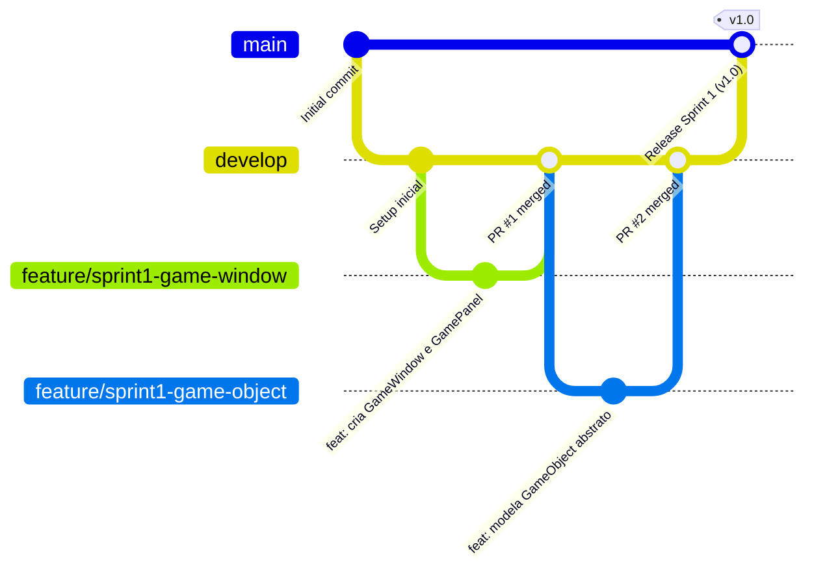

# 🛡️ Diretrizes de Engenharia e Padrões de Projeto: Space Defender Galaxy Core

Este documento estabelece as regras de desenvolvimento, convenções de código, governança de branches e fluxo de trabalho para a equipe (**Felipe Lopes** & **Bianca**).

---

## 🌿 1. Estratégia de Branching (GitFlow Adaptado)

Para garantir que o código que será apresentado ao professor esteja sempre estável e livre de bugs, utilizaremos uma versão simplificada e robusta do **GitFlow**:



### 📌 Nomenclatura das Branches
* `main`: Código de produção estável. **Nunca commitar diretamente na main**. Apenas merges vindos da `develop` ao final de cada Sprint.
* `develop`: Branch de integração contínua. É a base de onde saem e para onde voltam as tarefas das Sprints.
* `feature/sprint<X>-<descricao-curta>`: Branches individuais de trabalho criadas para cada Issue do GitHub.
  * *Exemplos:*
    * `feature/sprint1-setup-janela` (Tarefa 1.1)
    * `feature/sprint1-gameobject-player` (Tarefa 1.2)
    * `feature/sprint2-hierarquia-tiros` (Tarefa 2.1)
    * `feature/sprint3-colisoes-score` (Tarefa 3.2)
* `fix/<descricao-bug>`: Correções pontuais de bugs encontrados durante os testes em dupla na branch `develop`.

### 🔄 Regra de Pull Request (PR) e Code Review em Dupla
1. Cada membro cria uma branch a partir da `develop`.
2. Concluída a tarefa, abre um **Pull Request** apontando para `develop`.
3. **Regra de Ouro:** O colega de equipe deve revisar o PR e testar localmente antes de aprovar e realizar o merge (Felipe revisa Bianca, Bianca revisa Felipe).
   - *Por que isso é vital?* Na apresentação, o professor pode fazer perguntas para qualquer um dos dois. A revisão em dupla garante que ambos dominem 100% de cada linha escrita.

---

## 💬 2. Padrão de Commits (Conventional Commits)

Seguiremos o padrão semântico internacional com vinculação ao número da Issue no GitHub:

### Formato:
```text
<tipo>(<escopo>): <descrição no imperativo> (ref #<issue_id>)
```

### Prefixos Aceitos:
| Prefixo | Significado | Exemplo Prático |
| :--- | :--- | :--- |
| `feat` | Nova funcionalidade ou classe | `feat(window): implementa GameWindow e GamePanel a 60fps (ref #1)` |
| `fix` | Correção de defeito/bug | `fix(player): impede nave de ultrapassar borda lateral (ref #3)` |
| `refactor` | Melhoria de código sem alterar regra | `refactor(projectile): converte atributos para private com getters (ref #4)` |
| `style` | Formatação, identação, comentários | `style(gameloop): padroniza identação e comentários Javadoc` |
| `docs` | Documentação, relatórios ou guias | `docs(readme): adiciona instruções de execução e controles do jogo` |
| `chore` | Configurações do projeto, docker, gitignore | `chore(docker): configura imagem webtop com Java 21 e VS Code` |

---

## 📁 3. Estrutura de Pastas Padronizada (Clean Game Architecture)

A estrutura do projeto deve respeitar o pacote oficial `br.com.spacedefender` e isolar responsabilidades:

```text
PRBackend/
├── .github/                       # Templates de Issues, PRs e Workflows
├── .vscode/                       # Configurações recomendadas da IDE (settings.json, launch.json)
├── doc/                           # Documentações, cronogramas e anotações de estudo
│   ├── Cronograma_SpaceDefender_Felipe_Bianca.md
│   └── Diretrizes_Equipe_SpaceDefender.md
├── docker/                        # Configuração do ambiente isolado (Webtop / DevContainer)
│   ├── Dockerfile
│   └── docker-compose.yml
├── assets/                        # Recursos gráficos e sonoros (sprites PNG, trilha sonora WAV)
│   ├── sprites/
│   └── sounds/
├── src/                           # Código-fonte Java do Jogo
│   └── br/
│       └── com/
│           └── spacedefender/
│               ├── Main.java              # Ponto de entrada (public static void main)
│               ├── core/                  # GameLoop, GameWindow, GamePanel, GameState
│               ├── entities/              # GameObject (abstrato), PlayerShip
│               ├── projectiles/           # Projectile (abstrato), LaserPulse, PlasmaBall
│               ├── enemies/               # EnemyShip (abstrato), ScoutShip, ArmoredCruiser, BossShip
│               └── managers/              # WaveManager, CollisionManager, InputHandler
├── .gitignore                     # Ignora .class, bin/, target/ e arquivos temporários
└── README.md                      # Apresentação do projeto, comandos e capturas de tela
```

---

## 📋 4. Gestão do Board (GitHub Projects v2)

O Board Kanban no link `https://github.com/users/Felipe-Pinheiro-Lopes/projects/10/views/1` deve conter 4 colunas essenciais:

```text
┌─────────────────┬─────────────────┬─────────────────┬─────────────────┐
│  📋 A Fazer     │  ⏳ Em Progresso │  👀 Em Revisão   │  ✅ Concluído   │
│    (Todo)       │  (In Progress)  │   (In Review)   │     (Done)      │
└─────────────────┴─────────────────┴─────────────────┴─────────────────┘
```

### Regras de Transição dos Cards:
1. **A Fazer (Todo):** Todas as 12 tarefas mapeadas das Sprints 1 a 4.
2. **Em Progresso (In Progress):** Arraste o card quando iniciar a branch de desenvolvimento (`feature/...`). Limite de no máximo 1 card por pessoa simultaneamente.
3. **Em Revisão (In Review):** Arraste assim que abrir o Pull Request no GitHub. O outro membro testa na sua máquina.
4. **Concluído (Done):** Movido automaticamente após o PR ser aprovado e mergeado na `develop`.

---

## 🐳 5. Ambiente de Desenvolvimento com Docker (Estilo Webtop)

Seguindo a referência de sucesso do **Dockermine**, o ambiente Docker oferece:
- **Zero Instalação:** Não é necessário configurar JDK, variáveis `JAVA_HOME`, nem extensões no sistema operacional da máquina host.
- **Ambiente Idêntico para Ambos:** Elimina o clássico problema *"na minha máquina roda, na sua não"*.
- **Suporte a Janela Gráfica (Swing):** Como jogos Swing necessitam de um servidor gráfico (`DISPLAY`), o container baseado em **Webtop (XFCE)** transmite a área de trabalho para o navegador web via porta `3000`, permitindo rodar a janela do jogo e o VS Code lado a lado no navegador!
